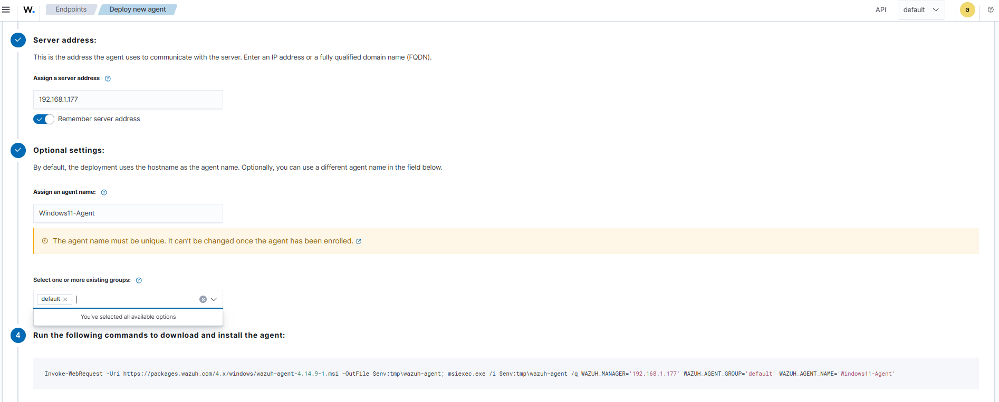
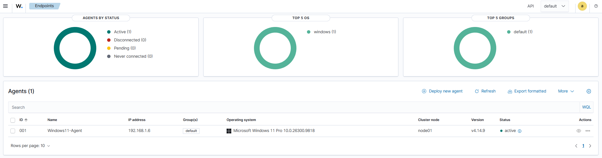
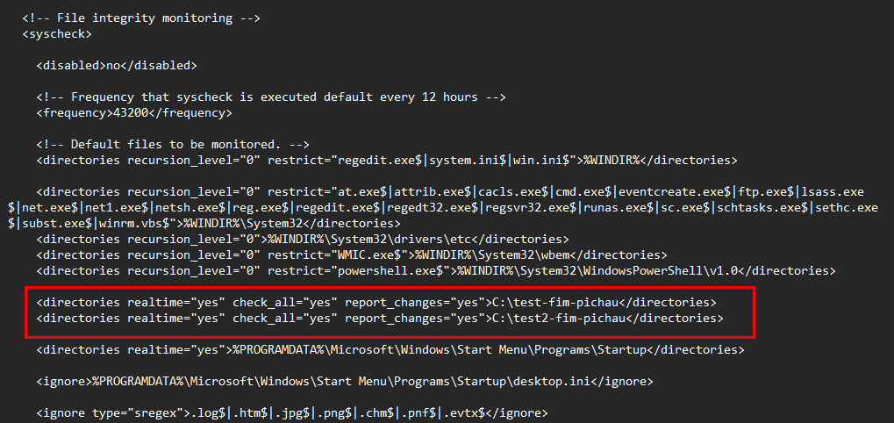
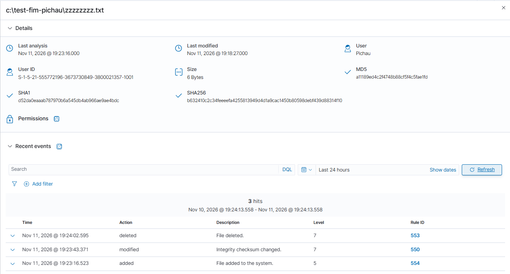
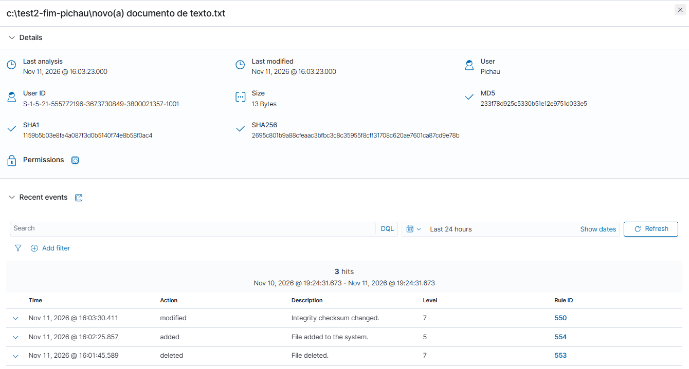
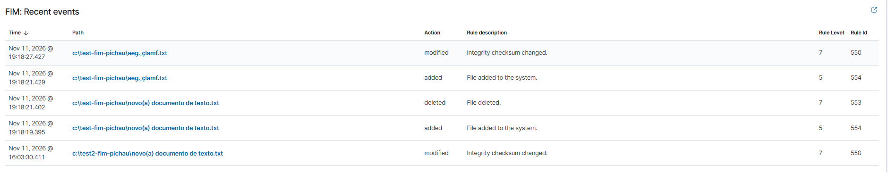
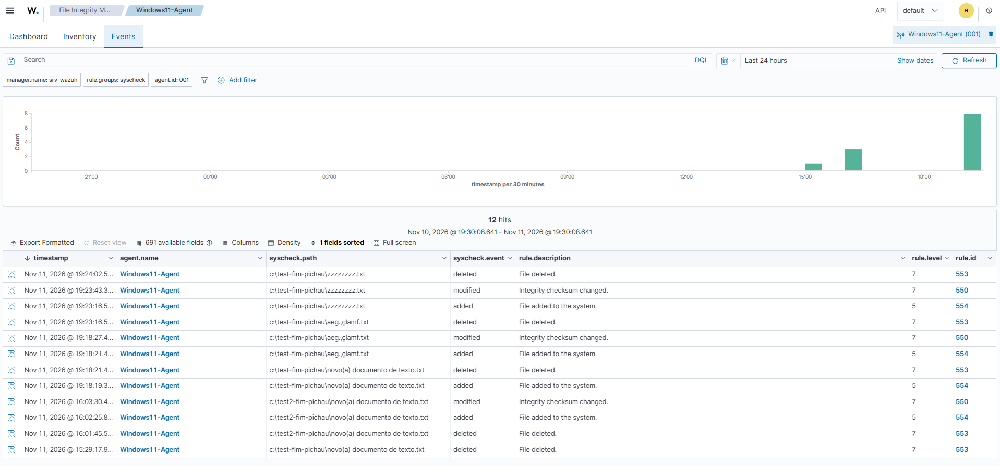
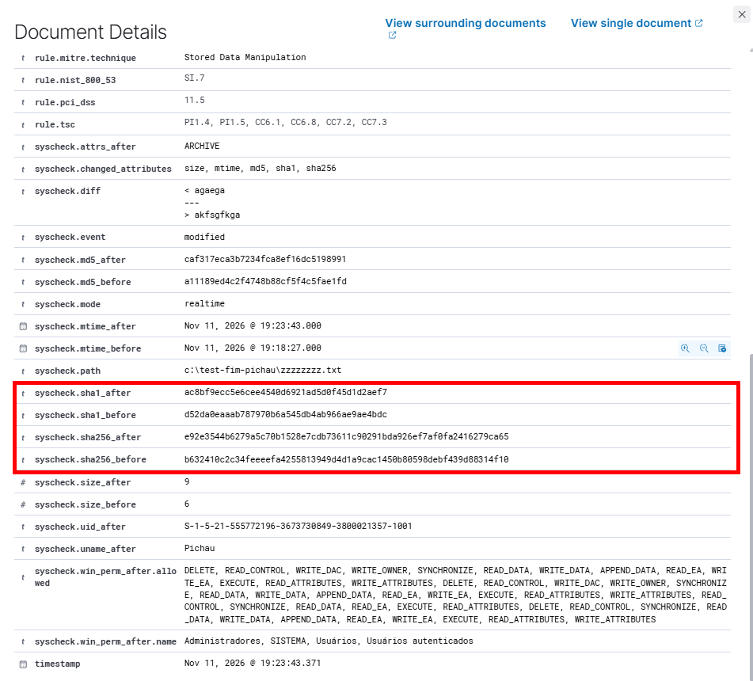
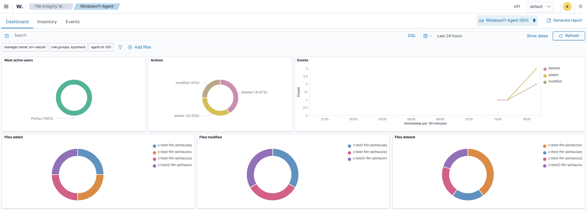

# Endpoint Security Monitoring & File Integrity Monitoring (FIM)

## 1. Sobre o projeto

Projeto desenvolvido em laboratório próprio, com o intuito de desenvolver habilidades em monitoramento de endpoints e identificação de alterações em arquivos e diretórios, utilizando Wazuh.

## 2. Objetivo

Implementar uma solução de monitoramento capaz de identificar alterações em arquivos, gerar alertas de segurança e permitir a análise dos eventos registrados no ambiente monitorado.

## 3. Tecnologias utilizadas

- Wazuh
- Wazuh Agent
- Windows 11
- File Integrity Monitoring (FIM)

## 4. Ambiente de laboratório

- Sistema operacional monitorado: Windows 11
- SIEM: Wazuh
- Endpoint: Pichau (PC)
- Ambiente: Laboratório virtualizado / próprio

## 5. Implementação

### 5.1. Instalação e configuração do Agent

Realizei a instalação através do passo a passo disponível na própria documentação do Wazuh (Wazuh agent): Primeiramente preenchi com o ID do meu Wazuh Server, escolhi um nome para meu endpoint, deixei "default" na parte groups (pois não havia criado nenhum grupo, já que, no momento, utilizei apenas um Agent) e depois colei o código disponibilizado no próprio Wazuh (para deploy do Agent no Windows) no PowerShell e finalizei subindo ele com um NET START Wazuh.

Agent conectado com sucesso:

### 5.2. Configuração do File Integrity Monitoring

Chegando na parte principal, a do File Integrity Monitoring (FIM), tive que fazer pequenas configurações no ossec.conf, presente na pasta ossec-agent.
Aqui parece simples, mas como foi minha primeira experiência prática fazendo isso, tive alguns problemas técnicos no começo, o que me levaram a entender onde estava o erro e o que eu poderia fazer para solucioná-lo.

Abaixo está a imagem do ossec.conf, aberto no bloco de notas pelo PowerShell, como administrador. (comando: notepad ossec.conf):

Parâmetros adicionados acima:
-realtime="yes": para monitorar na hora, sem ter que esperar a varredura periódica.
-check_all="yes": para comparar todos os atributos (hash, tamanho, permissões, dono e outros).
-report_changes="yes": guarda o que mudou no conteúdo, ajudando a ver a diferença no alerta.

### 5.3. Testes realizados

Foram realizados testes controlados no ambiente para verificar a capacidade de detecção do Wazuh.

**Testes executados (testei duas vezes, em diferentes arquivos):**

- Criação de arquivos.
- Modificação de arquivos.
- Exclusão de arquivos.

Arquivo 1: test-fim-pichau

Arquivo 2: test2-fim-pichau

No Arquivo 1 foi exido o padrão corretamente (criação, modificação e exclusão), mas no 2 foi registrado de forma diferente, no log. 
Isso aconteceu por causa de um problema simples que eu havia enfrentado no começo, de não ter dado Restart-Service -Name WazuhSvc no serviço. 
O restart é necessário após uma modificação ser realizada no .conf, para que seja atualizado e o arquivo registrado para ser monitorado entre em ação.
Como eu não havia executado tal comando, ficou como se eu ainda não tivesse adicionado ele na parte "<directories></directories>", não registrando a criação do documento.txt.

*Ponto importante: sempre restartar o serviço após modificar o .conf.*

### 5.4. Análise dos alertas

Eventos recentes ocorridos após modificações:

FIM Events: aqui é possível analisar todos eventos ocorridos após as modificações dos arquivos.

Análise dos hash antes e depois:

Isso serve para ter a certeza de que um arquivo não foi modificado, pois quando um arquivo é criado, um hash de criptografia é atribuído à ele automaticamente, para, assim, garantir a integridade do mesmo.

## 6. Resultados obtidos

A instalação e conexão do Agent ao WAZUH_MANAGER foi efetuada com êxito, conseguindo, posteriormente, analisar eventos de modificação, dos arquivos configurados para monitoramento (test e test2). 
Meu objetivo era simples, configurar meu Wazuh e fazer o deploy de um novo Agent e configurá-lo para analisar os eventos FIM. Porém, no decorrer do processo diversos imprevistos aconteceram, como:
1 - Não restartar o serviço após configurar;
2 - Ter deixado rastros mal configurados no .conf, o que fez eu ter um enorme aprendizado e saber o terrível impacto negativo que uma vírgula errada faz (ou qualquer dígito minimamente errado).

Cheguei no meu objetivo principal de conseguir acompanhar os alertas FIM. Abaixo mais um exemplo de monitoramento pelo FIM Dashboard:

## 7. Aprendizados

- Configuração e gerenciamento de Wazuh Agents.
- Monitoramento de integridade de arquivos.
- Identificação e análise de eventos de segurança.
- Interpretação de alertas em ambiente SIEM.

Além de ter cumprido com a missão de ter instalado o Agent e realizado a conexão dele ao WAZUH_MANAGER, obtive certa familiaridade com certos comandos na CLI do Windows PowerShell e aprendi a evitar erros bobos que, normalmente, quebrariam com meu sistema Wazuh. 

## 8. Conclusão

Configurei arquivos para monitorar a integridade dos mesmos e consegui analisá-los a cada pequena modificação realizada neles.
Praticar e errar é a melhor forma de aprender algo e se familiarizar com determinado conteúdo.
Agora o objetivo é fortalecer os conhecimentos com novas melhorias futuras e, assim, alcançar o nível de excelência desejado.

---

**Projeto desenvolvido para fins educacionais em laboratório próprio.**
